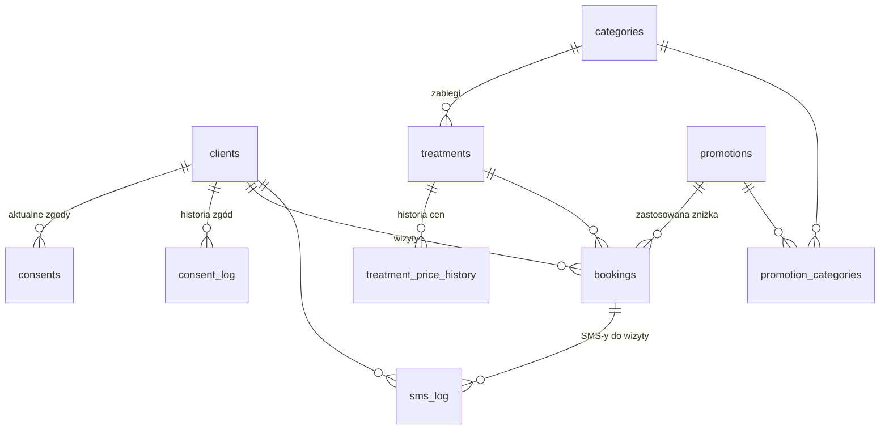

# Baza danych

Schemat dla PostgreSQL 15+ (zgodny z Supabase). Prototyp strony jeszcze z niej nie korzysta: dane zapisuje w przeglądarce. Baza będzie potrzebna przy przenoszeniu strony na Next.js.

| Plik | Co zawiera |
|---|---|
| `schema.sql` | Tabele, klucze, ograniczenia, triggery, funkcje i widoki |
| `seed.sql` | Dane startowe: kategorie, 29 zabiegów z opisami i cenami, godziny pracy, dni wolne, promocje, konto gabinetu oraz klientki i wizyty **przykładowe** |
| `generate-seed.js` | Tworzy `seed.sql` z danych strony (`assets/js/config.js`, `treatments.js`) |
| `tests.sql` | Testy: wolne terminy, blokady, Omnibus, zgody, anonimizacja |

## Jak uruchomić

**Supabase:** SQL Editor → wklej i uruchom `schema.sql`, potem `seed.sql`.

**Lokalnie (psql):**

```bash
psql -d jm -f database/schema.sql
psql -d jm -f database/seed.sql
psql -d jm -f database/tests.sql   # opcjonalnie, na bazie testowej
```

Po zmianie zabiegów lub cen w `assets/js/treatments.js` wygeneruj dane od nowa:

```bash
node database/generate-seed.js
```

`schema.sql` za każdym razem usuwa i tworzy od nowa schemat `salon`, więc **nie uruchamiaj go na bazie z prawdziwymi danymi**.

## Tabele



| Tabela | Do czego służy |
|---|---|
| `clients` | Klientki z kontem i goście. Jedna osoba = jeden wiersz (po e-mailu), więc gość, który zakłada konto, zachowuje historię wizyt |
| `consents` | Aktualny stan zgód: regulamin, polityka prywatności, oferty SMS, oferty e-mail |
| `consent_log` | Historia każdej zmiany zgody, wypełniana automatycznie. Nie da się jej edytować (dowód dla RODO) |
| `categories`, `treatments` | Zabiegi z pełnymi opisami, czasem trwania i ceną (także „od”) |
| `treatment_price_history` | Historia cen, zapisywana automatycznie przy zmianie ceny |
| `promotions`, `promotion_categories` | Zniżka powitalna, promocje sezonowe i urodzinowe, z wyborem kategorii |
| `working_hours`, `days_off` | Godziny pracy w tygodniu, święta i urlopy |
| `bookings` | Wizyty: termin, status, cena w chwili rezerwacji, zniżka, kwota do zapłaty (liczona automatycznie) |
| `sms_log` | Potwierdzenia, przypomnienia, odwołania i kampanie SMS |
| `admins` | Konta do panelu: `owner` (Justyna, właścicielka), `admin` (Martyna, administratorka strony), `staff` (ewentualne pracownice) |

## Zasady pilnowane przez samą bazę

- **Brak podwójnych rezerwacji:** dwie aktywne wizyty nie mogą na siebie nachodzić (`bookings_no_overlap`). Odwołana wizyta zwalnia termin.
- **Zniżka powitalna tylko raz** na klientkę (`one_welcome_discount_per_client`).
- **Konto musi mieć logowanie:** `has_account = true` wymaga Supabase Auth albo hasła.
- **Historia zgód tylko do dopisywania:** każda zmiana w `consents` trafia do `consent_log`.
- **Jedno przypomnienie SMS** na wizytę.

## Funkcje i widoki

| Nazwa | Co robi |
|---|---|
| `available_slots(dzień, czas_min, krok_min)` | Wolne terminy z uwzględnieniem godzin pracy, dni wolnych i umówionych wizyt |
| `lowest_price_30d(zabieg, moment)` | Najniższa cena z 30 dni przed obniżką (dyrektywa Omnibus) |
| `anonymize_client(id)` | Usunięcie konta na życzenie klientki: dane osobowe znikają, wizyty zostają w dokumentacji |
| `v_upcoming_bookings` | Nadchodzące wizyty do panelu |
| `v_clients_overview` | Baza klientek z liczbą wizyt, ostatnią wizytą i zgodami |
| `v_sms_campaign_recipients` | Odbiorczynie kampanii SMS, tylko z aktualną zgodą |
| `v_reminders_due` | Wizyty, do których trzeba teraz wysłać przypomnienie |

## Przed użyciem z prawdziwymi danymi

- Usuń dane przykładowe z `seed.sql` (sekcje oznaczone **PRZYKŁAD**).
- Włącz Row Level Security w Supabase: klientka widzi tylko swoje dane, panel tylko konto gabinetu.
- Dane o zdrowiu z karty konsultacyjnej trzymaj poza tą bazą, a w `salon_notes` nie zapisuj informacji o zdrowiu.
- Uzupełnij dane firmy i politykę prywatności, a z dostawcą bazy podpisz umowę powierzenia danych.
